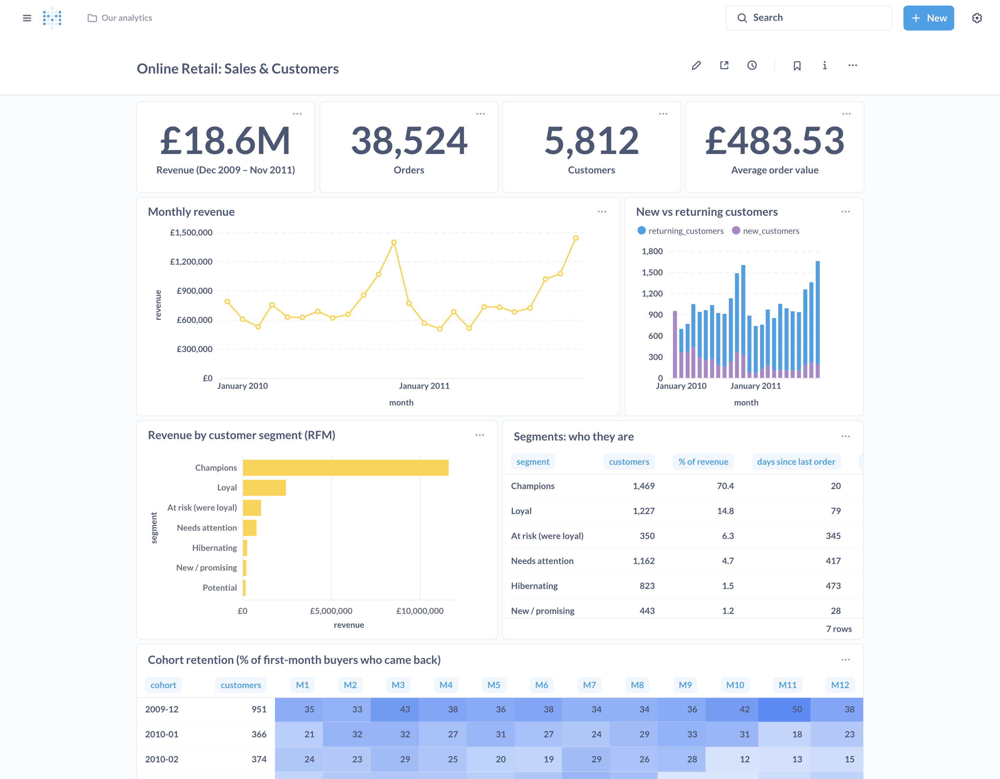

# Retail Analytics: 1 million real transactions → clean data → dashboard → decisions

[](https://github.com/dinulimann/retail-analytics/actions/workflows/tests.yml)

An end-to-end analysis of the [UCI Online Retail II](https://archive.ics.uci.edu/dataset/502/online+retail+ii) dataset: two years of real transactions (1,067,371 lines) from a UK online gift wholesaler. The raw data is messy; the cleaning is explicit and tested; the analysis lives in SQL; the dashboard is built in Metabase from code; and the result is a short report of findings with recommendations.



**Read the findings: [docs/insights.md](docs/insights.md).** Highlights:

- Revenue grew **2.5%** year over year while orders **fell 3.7%**: growth came entirely from larger orders (+6.5% average order value).
- **25% of customers bring 70% of revenue.** 350 formerly loyal customers have been silent for ~a year; together they spent £1.04M.
- About **20%** of new customers come back the next month, and that share barely changes over the following year, so the first 30 days decide whether a customer stays.
- September–November is **37%** of annual revenue.
- The two largest export markets depend on very few accounts: Ireland is **3 customers**, the Netherlands **22** with an average order of £2,553.

## The data was messy, and the cleaning is part of the work

| Rule | Lines removed |
|---|---:|
| Exact duplicates, including a **2010-12-01..09 overlap** between the file's two sheets | 34,335 |
| Non-product lines: postage, Amazon fees, manual adjustments, bad debt, samples, vouchers | 5,970 |
| Cancellations (`C…` invoices), moved to their own table rather than deleted | 17,914 |
| Stock adjustments: negative quantities on normal invoices, with notes like "short" | 3,365 |
| Zero or negative prices | 2,566 |
| Orders entered by mistake and cancelled with the identical quantity (one of them **80,995 units**) | 6,180 |
| **Clean sales lines** | **997,041** |

The last rule matters most. Without it, two customers who mistyped an order and cancelled it minutes later would look like the biggest buyers in the dataset. Each rule is a named step in [`src/clean.py`](src/clean.py), reports how many rows it removed (also shown on the dashboard), and has a unit test.

## What's in the analysis

All in SQL ([`sql/02_analytics.sql`](sql/02_analytics.sql)), as materialized views the dashboard reads:

| View | Question it answers |
|---|---|
| `monthly_kpis` | Revenue, orders, customers, average order value per month |
| `new_vs_returning` | How many buyers each month are new, and how much revenue comes from returning ones |
| `cohort_retention` | Of the customers who first bought in month X, what share is still buying N months later |
| `rfm`, `rfm_segments` | Recency / frequency / monetary quintiles → Champions, Loyal, At risk, Hibernating… |
| `top_products`, `country_summary` | What sells and where |
| `product_pairs` | Market basket analysis: support, confidence and lift for products bought together |
| `order_timing` | Orders by weekday and hour |
| `cancellation_rate` | Cancelled value as a share of sales, per month |

The full dashboard, including cohort retention, top products and countries, product pairs, order timing and the data quality table: [docs/dashboard-full.png](docs/dashboard-full.png).

## Run it

Requires Docker and Python 3.10+.

```bash
docker compose up -d                       # PostgreSQL (5552) + Metabase (3001)
python -m venv .venv && source .venv/bin/activate
pip install -r requirements.txt

python scripts/load.py                     # downloads the data, cleans it, loads PostgreSQL (~20 s after download)
python scripts/metabase_setup.py           # builds the dashboard through the Metabase API
```

Open http://localhost:3001 (login printed by the script). The dashboard is created by code, so it can be rebuilt from scratch at any time.

```bash
pytest                                     # cleaning rules, on small hand-made frames
```

## Layout

```
src/clean.py               cleaning rules, each one counted
scripts/load.py            download → clean → COPY into PostgreSQL → build analytics views
scripts/metabase_setup.py  admin user, database connection, 14 questions and the dashboard via the API
sql/01_schema.sql          tables: sales, cancellations, data_quality
sql/02_analytics.sql       the analysis, as materialized views
docs/insights.md           findings and recommendations
tests/                     pytest
```

## Data source and license

Daqing Chen, *Online Retail II*, UCI Machine Learning Repository (2019), [doi:10.24432/C5CG6D](https://doi.org/10.24432/C5CG6D), licensed under CC BY 4.0. The data is downloaded at run time and is not stored in this repository.

## Tech

Python · pandas · PostgreSQL 16 · SQL (window functions, materialized views) · Metabase · pytest · Docker
